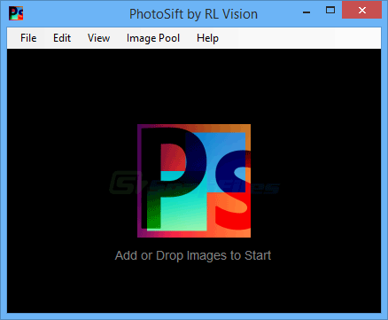
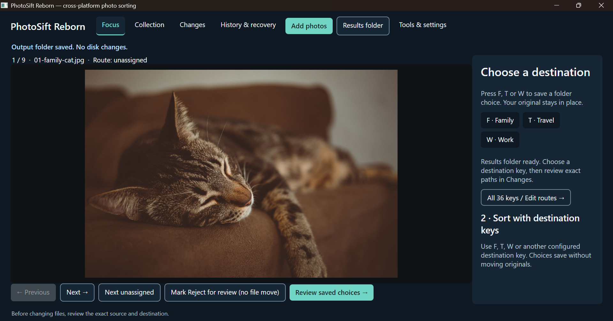

# PhotoSift Reborn

**Keyboard-speed photo sorting, rebuilt as an Avalonia desktop experience.**

PhotoSift Reborn is an independent, GPLv3-licensed modernization of [PhotoSift by RL Vision](https://github.com/rlv-dan/PhotoSift), the pre-existing Windows photo organizer. It preserves the idea that made the original useful: inspect a photo, use a key to decide where it belongs, and move through a collection quickly. Reborn rethinks the experience around **Focus, Collection, Changes, History, Tools and Diagnostics**, with a cohesive Midnight Jade design and a more explicit distinction between a *sorting decision* and an *actual filesystem change*.

**Avalonia Port Challenge entry — Best Everyday Tool.** Windows x64 and Linux x64 are the tested release targets. macOS is **not** claimed as tested or supported for native file operations.

> **Release scope:** This README describes the independently tested **R30-R3 polished presentation release**. Experimental R31 and R31-R2/R31-R3 development features are **not included** in this release, and are not represented as shipped capabilities. R30-R3 retains deliberate restrictions on unsafe ordinary mixed-family workflows and other unproven native mutation scenarios.

## See the original and the rebuild

The comparison below uses an archived third-party screenshot of the original PhotoSift, obtained from [SnapFiles](https://www.snapfiles.com/screenfiles/photosift.png) (438 x 361 pixels, original watermark preserved). It is not a screenshot captured by this project. The Reborn screenshots show the actual application. Image rights remain with their respective holders.

| Before: RL Vision PhotoSift | After: PhotoSift Reborn (Windows) |
| --- | --- |
|  |  |

Additional authentic captures: [Collection](docs/screenshots/after-reborn-collection.png) · [Changes](docs/screenshots/after-reborn-changes.png) · [History](docs/screenshots/after-reborn-history.png) · [Ubuntu Focus](docs/screenshots/after-ubuntu-focus.png).

## Download and launch

**Release downloads: [R30-R3 Windows and Linux](https://github.com/chizzydev/photosift-reborn-avalonia/releases/tag/contest-r30-r3-20261023) (verify after publication).**

| Target | Asset | Start |
| --- | --- | --- |
| Windows x64 | `PhotoSiftReborn-Final-Presentation-win-x64-CANDIDATE.zip` | Extract fully, then launch `PhotoSiftReborn.exe`. |
| Ubuntu/Linux x64 | `PhotoSiftReborn-Final-Presentation-linux-x64-CANDIDATE.tar.gz` | Extract fully in a user-owned directory, then run `./PhotoSiftReborn` from a graphical session. |

Both are .NET 10 **self-contained portable** archives, not signed installers. No .NET SDK is required for the published app itself. Linux may require system GUI/runtime libraries; see [judge quick-start](docs/JUDGES_QUICK_START.md). **Do not run as Administrator/root.** Do not install over the legacy PhotoSift directory or move its `Settings.xml` into the new application's data directory.

For a first trial, use copies of disposable photos and a separate destination. Marking/reviewing a sorting choice is not the same as applying a file operation. Before any actual filesystem action, review its exact source, destination and consequences. **Do not use unapproved/experimental Move, Rename, Reject or mixed-family chains on irreplaceable personal photographs.** Keep session databases, journals and app-owned recovery material intact.

## What changed in the migration

The legacy PhotoSift UI was a direct, keyboard-first Windows Forms-era utility. The rewrite moves the presentation to **Avalonia 12 / .NET 10**, with a multi-view Studio and shared application, core and filesystem layers. Reborn adds a collection overview with on-demand photo previews; review-oriented changes; history and recovery surfaces; and inspectable diagnostics. The design prioritizes discoverable decisions and recovery state over immediate implicit writes.

The hard engineering problem was **not drawing a modern UI**. Persisted UI selections are not proof that a filesystem object is still the same original the user approved. Reborn therefore uses SQLite-backed operation history, native identity checks, bounded reviewed authority, collision refusal and explicit verified recovery/Undo for the supported generated-only acceptance paths. Windows and Linux require different native primitives and sometimes retain different conservative refusal boundaries.

The result is not a claim that every file on every filesystem can be manipulated safely. Unsafe ownership, unsupported device/path conditions and arbitrary repeated mixed-family operations may remain held rather than being silently forced through.

### Provenance and licence

The original application existed well before the competition (RL Vision PhotoSift, publicly released in 2014); upstream project: [rlv-dan/PhotoSift](https://github.com/rlv-dan/PhotoSift). Our baseline attribution references upstream commit `a5e83b9198f5dd251053c48182cc37fea9ff6670`. PhotoSift Reborn is **not an official RL Vision release**. Source and corresponding modified source are distributed under GPLv3 terms. See `LICENSE-GPLv3.txt` in the source and release archives.

## The honest migration account

### What transferred well

The core interaction is still recognizable: a person reviews a photograph and assigns a keyboard route. Existing PhotoSift workflows supplied a clear functional reference. Avalonia let the new application share one visual system across Windows and Linux while keeping the quick review loop visible in Focus.

### What had to be redesigned

**State and safety.** The legacy app could associate a keypress directly with a file move/copy. Reborn separates *choose*, *review* and *apply*, because stale approvals, changed files or destination collisions must not be treated as permission to overwrite. SQLite journals and native revalidation protect supported operation lifecycles across restart and Undo.

**Cross-platform native behavior.** Avalonia replaces the UI stack, not Windows and Linux filesystem semantics. Platform-specific ownership/pinning and no-replace operations required separate code and evidence. We did not infer macOS correctness from Avalonia's theoretical reach, and we did not assume identical adversarial resistance on Linux and Windows.

**Recovery as product UX.** Reborn exposes History and recovery information rather than hiding journal state in implementation internals. The user can see that a recorded operation and its verified Undo are separate events, and a held operation is not a silent success.

**Migration compatibility.** Legacy `Settings.xml` options cannot simply be copied into a different application's SQLite workspace. Reborn offers bounded preview/import affordances, but complete option parity and automatic import of historical undo state are not claimed. Legacy and Reborn should be installed separately.

### What the migration cost and what went wrong

This was a substantive desktop rewrite, not a one-to-one control repaint. Engineering required repeated native-safety increments, cross-platform releases, recovery-journal checks, new GUI workflows and generated-only destructive test fixtures. Work on Linux surfaced platform-specific native boundary problems; interruption during a Rename owner workflow required read-only inspection and controlled continuation, not replay of an already-executed action. A separate Reject verification issue needed the verifier fixed rather than relaxing correctness rules.

The practical tradeoff is deliberate: compared with a carefree instant move/delete interface, operations with uncertain ownership may demand explicit review or remain unavailable. We chose conservative refusal over making risky actions look effortless.

### Measured outcome and remaining limitations — R30-R3 only

The accepted/polished R30-R3 **native self-test evidence** reports **1,274/1,274 PASS on Windows** and **1,286/1,286 PASS on Ubuntu**, with zero failures in those scoped suites. The portable Windows release was actually opened by the owner and its Focus, Collection, Changes, History, Tools and Diagnostics screens reviewed against generated photos. The Ubuntu portable was extracted and opened in a GUI session; generated photos displayed and the application exited cleanly. These results **do not prove unrestricted safety for personal files, all file systems, or macOS.** Test counts are native case results, not counts of real-user photo moves.

The R30-R3 native scope remains deliberately constrained. Safe general mixed-family ordinary-photo authority, all original Settings.xml options, every filesystem/platform combination, broad accessibility/performance benchmarking and a completely clean no-SDK machine test are **not independently certified** by this release. We do not borrow newer experimental R31 test results for R30.

### What developers can inspect

This public repository provides the clean buildable corresponding source (application, core, filesystem layers, required assets/fixtures, licence and build configuration) selected from a hash-verified 794-entry R30-R3 development archive, with the exact verified **Studio presentation C# overlay** applied. Historical internal handoff notes and logs are intentionally excluded from the public Git history; the complete original audit archive remains privately preserved. The tag supplies a downloadable source snapshot. Release checksums, underlying licence/attribution, native tests and release notes are kept separate from accepted test laboratories.

For the source architecture, inspect `src/PhotoSiftReborn.App`, `src/PhotoSiftReborn.Core` and `src/PhotoSiftReborn.IO`. For installation and constraints, see the [judge quick-start](docs/JUDGES_QUICK_START.md) and [R30-R3 release notes](docs/RELEASE_NOTES_R30_R3.md).

## Contest details

This entry targets **Best Everyday Tool**: a small practical utility modernized with a cohesive experience and intentionally strong recoverability boundaries. We submit two actually tested desktop targets, **Windows x64 and Ubuntu/Linux x64**; we make **no three-platform Windows/macOS/Linux prize claim**.

Official challenge and judging rules: https://avaloniaui.net/blog/avalonia-port-challenge.
